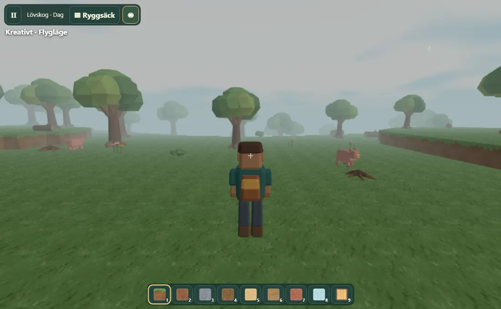

# Blockvärlden – verifierat spelflöde

Testad spelversion är 481d36a. Testkoden utökades därefter i a47bc0c för att även köra på separata Windows- och macOS-maskiner.

## Vad webbläsarprovet gör

Provet öppnar spelets ordinarie startsida, skapar en kreativ värld med fröet Expedition, inväntar terräng och väljer tredjepersonskamera. Därefter mäter det bildfrekvensen under 2,5 sekunder och tar en skärmbild. Det väljer tegel i den sökbara ryggsäcken, växlar till överlevnad, tillverkar ett föremål, sparar och går till startmenyn. Till sist laddar det om hela sidan och fortsätter den sparade världen. I mobilprofilerna kontrolleras också att joystick, handlingsknappar och snabbvalsfält ryms inom skärmen.

| Testmiljö | Spelflöde | Uppmätt FPS |
| --- | --- | ---: |
| Windows, installerad Google Chrome, 1100 × 680 | Godkänt | 29,5 |
| Linux, Chromium, skrivbord, mjukvarurendering | Godkänt | 11,4 |
| Linux, Chromium, Pixel 7-profil i liggande läge, mjukvarurendering | Godkänt | 9,6 |
| Linux, WebKit, iPhone 13-profil i stående läge, mjukvarurendering | Godkänt | 22,5 |

GitHubs separata macOS-WebKit-prov stod fortfarande i kö utan tilldelad maskin när protokollet sparades. Aktuell status framgår av körningslänken nedan.

Mätvärdena kommer från delade testmaskiner med adaptiv grafik aktiverad. De beskriver en kort sekvens vid startplatsen. Målen för Windows-datorer med spelgrafik, fysiska Chromebooks, Android-enheter, iPhone och iPad behöver mätas på representativa enheter. Safari på riktiga Apple-enheter och längre spelsessioner återstår.

En tidigare körning hittade att en snabb omladdning kunde avbryta återgången till menyn före avslutad skrivning. Den uppdaterade versionen sparar också när spelaren lämnar ryggsäck eller pausmeny. Regressionstestet inväntar bekräftad återgång till startsidan innan det laddar om. Samtliga tre Linuxprofiler har sedan klarat två på varandra följande körningar.

## Källor

- [Webbläsarkörning med Windows, Linux och macOS](https://github.com/fritidsparken/fritidsparken.github.io/actions/runs/41914887323)
- [Föregående godkända körning av samtliga tre Linuxprofiler](https://github.com/fritidsparken/fritidsparken.github.io/actions/runs/41914728569)
- [Teknisk omfattning och återstående utveckling](../../games/blockvarlden/UTVECKLING.md)
